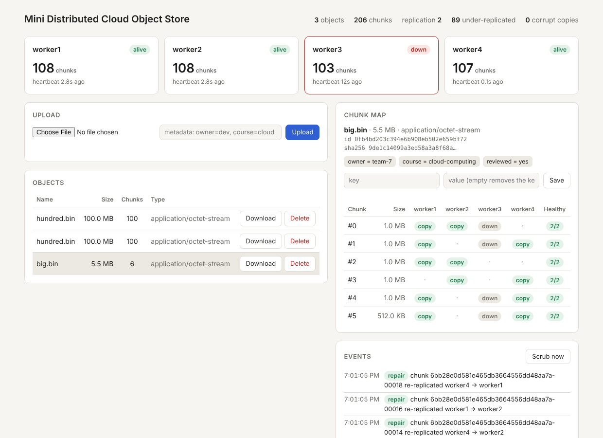
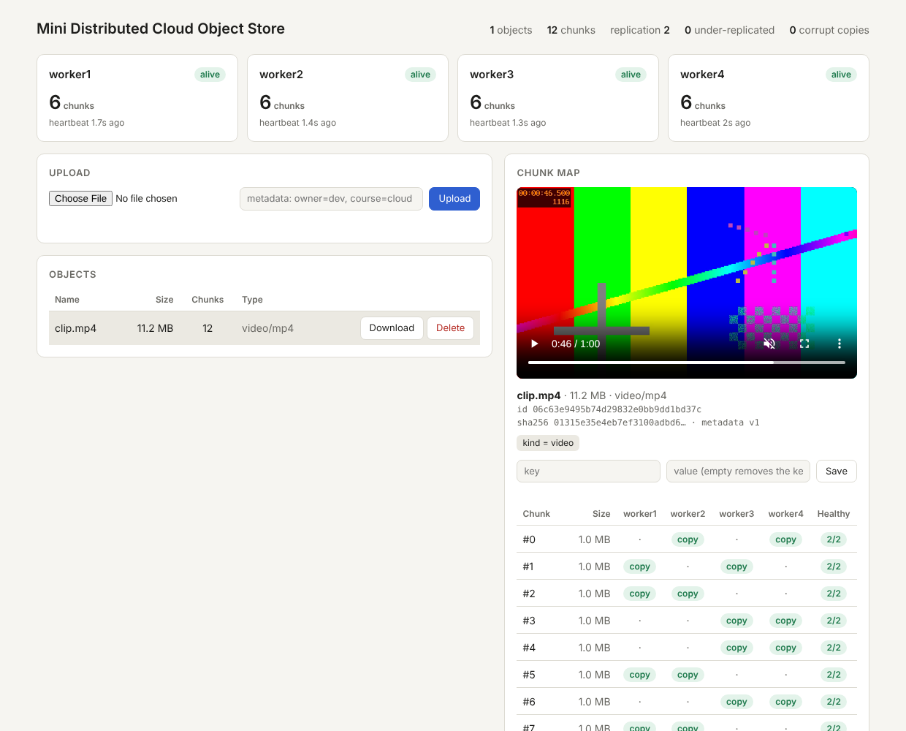
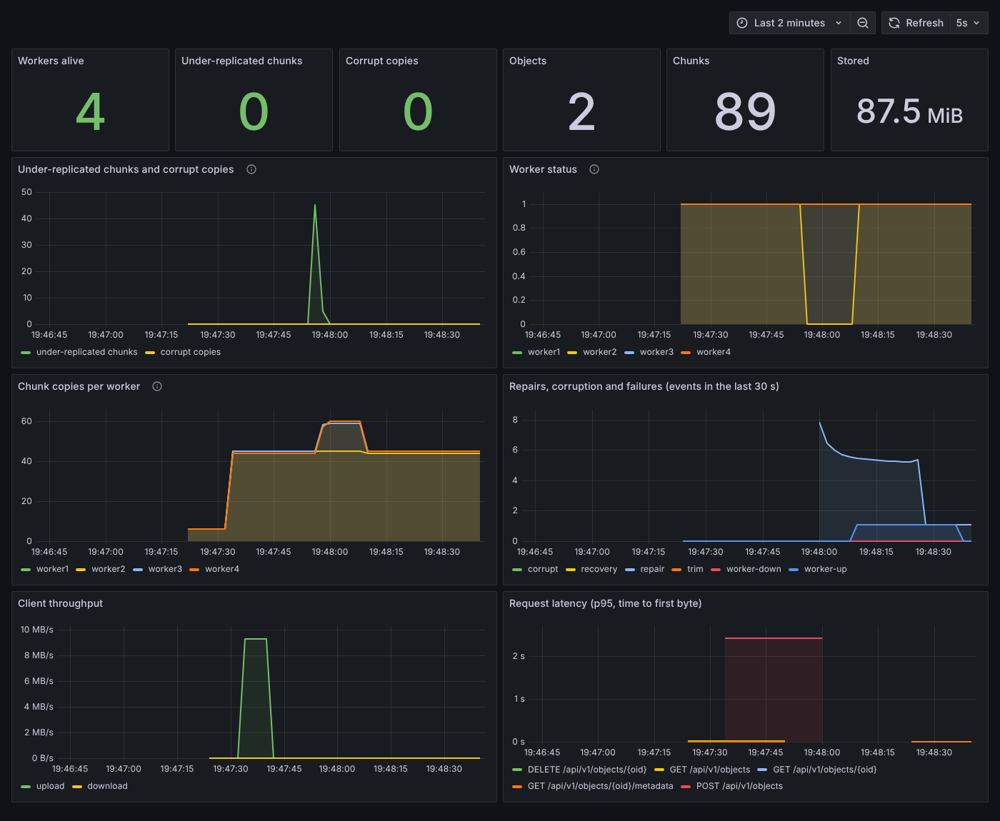

# Mini Distributed Cloud Object Store

A small distributed object store: one controller and four storage workers, all in Docker.
Any file can be uploaded. It is cut into 1 MB chunks, and every chunk is kept on two
different workers. The store survives a worker failure, restores the lost copies by itself,
and detects and repairs corrupted data.



## Quick start

You need Docker Desktop (or Docker Engine with the Compose plugin).

```bash
docker compose up --build -d      # 1 controller + 4 workers
docker compose ps                 # all five should be "Up"
```

Then open **http://localhost:8000** for the dashboard, or use the API:

```bash
curl -X POST http://localhost:8000/api/v1/objects \
     -F "file=@photo.jpg" \
     -F 'metadata={"owner":"devdeep","album":"trip"}'
```

Stop everything with `docker compose down`. The data stays in Docker volumes;
add `-v` to wipe it.

## Architecture

```
                 client (curl / CLI / dashboard)
                              |
                   REST  /api/v1/objects...
                              |
                 +------------v-------------+
                 |        controller        |   SQLite: objects, chunks,
                 |  chunking, placement,    |   replicas, workers
                 |  metadata, repair, scrub |   (volume: controller-data)
                 +--+------+------+------+--+
     /internal/chunks/{id}  |      |      |      ^ register + heartbeat
                    |      |      |      |      | every 3 s
               +----v-+ +--v---+ +v-----+ +v-----+
               |worker1| |worker2| |worker3| |worker4|   each with its own
               +------+ +------+ +------+ +------+   volume, chunks as files
```

- **Controller** is the only thing clients talk to. It splits uploads into chunks, picks
  workers, keeps all metadata, watches worker health and repairs replication. It never
  stores object data itself.
- **Workers** are simple chunk stores. A chunk is one file under `/data/chunks/` on the
  worker's own volume. Workers register with the controller on start and heartbeat every 3 s.
- **Clients** never learn where chunks are; they only use object IDs.

### What happens on upload

1. The controller reads the file 1 MB at a time (it never holds the whole file in memory).
2. For each chunk it computes a SHA-256 checksum and picks the two live workers that hold
   the fewest chunks.
3. It sends the chunk to both in parallel. A worker re-hashes what it received and refuses
   it if the checksum differs. If a write fails, another worker is tried.
4. When every chunk has two copies, the object is marked `ready` and `201` is returned.
   If two copies cannot be stored, everything written so far is removed and the client gets `503`.

### What happens on download

For each chunk, in order, the controller fetches a copy from a live worker and **checks its
checksum before sending it on**. If the copy is corrupt, missing, or the worker does not
answer, it uses the other copy. Corrupted data is never returned to the client.

### Failure handling

| Event | What the controller does |
|---|---|
| Worker stops heartbeating for 10 s | Marks it `dead`. Reads already fall back to the other copy before that. |
| Chunk has fewer than 2 healthy live copies | Repair loop (every 5 s) copies it from a verified good copy to another live worker. |
| Dead worker comes back | Its disk is audited: valid chunks are counted again, chunks of objects deleted meanwhile are removed. Chunks that now have 3 copies are trimmed back to 2. |
| A copy fails its checksum (on read or during scrub) | Marked `corrupt`, never served, then overwritten in place from a good copy. |
| A chunk file vanished from a worker's disk | Detected by the scrub, treated like a lost copy and re-replicated. |
| Controller restarts | Object and chunk metadata is in SQLite on a volume. Chunk locations are rebuilt from the workers' own reports (safe mode, see below). |
| Controller loses its database | Restored from the copy on the backup volume, then chunk locations are rebuilt the same way. |

The **scrub** re-hashes every chunk on every live worker every 30 s and compares with the
stored checksums. `POST /api/v1/admin/scrub` runs it immediately.

**Limit worth knowing:** with replication factor 2, any single worker can fail without data
loss. If two workers that share a chunk are down at the same time, objects using that chunk
return `503` until one of them is back.

### Controller crash and recovery

The controller is the one component without a replica, so it is built to come back cleanly:

- **Backup.** A few seconds after any metadata change, the database is copied (SQLite online
  backup) to a second volume, `controller-backup`. If the live database is missing or damaged
  at start, the controller restores this copy.
- **Chunk locations are not trusted across restarts.** At every start the controller forgets
  where chunks are and asks each worker what it holds (`GET /internal/workers/{id}/chunks`
  with checksums). The location map is rebuilt from those answers. This is how HDFS treats
  block locations.
- **Safe mode.** Until every known worker has reported (or 15 s have passed), the controller
  does not repair anything and answers uploads and deletes with `503`. Without this it would
  see "missing" copies and start copying data for no reason. Downloads work as soon as the
  needed chunks have been reported.

`./scripts/lose_metadata.sh` demonstrates it: it deletes the live database, kills the
controller, restarts it, and prints the recovery events.

What is lost if the database is destroyed: only changes made in the few seconds since the
last backup. Real systems close this gap with a replicated log (GFS operation log, HDFS
JournalNodes) and a standby controller.

## Client REST API

| Method | Endpoint | Purpose | Success |
|---|---|---|---|
| POST | `/api/v1/objects` | Upload an object | 201 |
| GET | `/api/v1/objects/{object_id}` | Download an object | 200 |
| GET | `/api/v1/objects/{object_id}/metadata` | Retrieve metadata | 200 |
| PATCH | `/api/v1/objects/{object_id}/metadata` | Update custom metadata | 200 |
| DELETE | `/api/v1/objects/{object_id}` | Delete an object | 204 |
| GET | `/api/v1/objects` | List stored objects | 200 |

Interactive docs are generated at http://localhost:8000/docs.

```bash
API=http://localhost:8000/api/v1

# upload: multipart/form-data, field "file" required, field "metadata" optional (JSON object)
curl -X POST $API/objects -F "file=@video.mp4" -F 'metadata={"owner":"devdeep"}'

# download: the original bytes, with the original Content-Type
curl $API/objects/<object_id> -o copy.mp4

# metadata: system fields, custom fields, and every chunk with its locations
curl $API/objects/<object_id>/metadata

# update custom metadata: keys are added or replaced, a null value removes a key
curl -X PATCH $API/objects/<object_id>/metadata \
     -H 'Content-Type: application/json' -d '{"reviewed":"yes","owner":null}'

# list, with optional pagination
curl "$API/objects?limit=20&offset=0"

# delete
curl -X DELETE $API/objects/<object_id>
```

Metadata response (shortened):

```json
{
  "object_id": "0fb4bd203c394e6b908eb502e659bf72",
  "name": "big.bin",
  "size": 5767168,
  "content_type": "application/octet-stream",
  "created_at": "2026-11-12T18:58:17+00:00",
  "modified_at": "2026-11-12T18:58:18+00:00",
  "checksum": "9de1c14099a3ed58...",
  "checksum_algorithm": "sha256",
  "chunk_count": 6,
  "chunk_size": 1048576,
  "state": "ready",
  "custom_metadata": {"owner": "team-7", "reviewed": "yes"},
  "chunks": [
    {
      "chunk_id": "0fb4bd203c394e6b908eb502e659bf72-00000",
      "index": 0,
      "size": 1048576,
      "checksum": "5d1f...",
      "healthy_copies": 2,
      "replicas": [
        {"worker": "worker1", "state": "ok", "alive": true},
        {"worker": "worker3", "state": "ok", "alive": true}
      ]
    }
  ]
}
```

### Partial downloads (Range)

`GET /api/v1/objects/{id}` accepts `Range: bytes=start-end` and answers `206 Partial Content`.
Only the chunks that overlap the range are read from the workers, and each one is still
verified before any part of it is sent. A range that starts past the end gets `416`.
`HEAD` returns the size and `Accept-Ranges: bytes`.

```bash
curl -H "Range: bytes=1048000-1049000" $API/objects/<object_id> -o part.bin
curl -H "Range: bytes=-500" $API/objects/<object_id>          # last 500 bytes
```

This is what lets the dashboard play a stored video and jump to any position: select a video,
audio or image object and a player appears above the chunk map. The Events panel shows which
chunks each range read touched.

The chunk map also has a "Download a part" form (first and last byte) and an arrow in every
chunk row that downloads just that chunk. Both send a Range request to the same endpoint.



### ETags and conditional requests

| Header | On | Effect |
|---|---|---|
| `ETag` (response) | object download | The object's SHA-256. Never changes, objects are immutable. |
| `ETag` (response) | metadata GET / PATCH | `"v<n>"`, increases on every metadata update. |
| `If-None-Match` | GET object | `304 Not Modified` if the caller's copy is current. |
| `If-Match` | PATCH metadata, DELETE | `412 Precondition Failed` if the object changed since the caller read it. |

The metadata response is sent with `Cache-Control: no-store` and never answers `304`: besides
the custom metadata it lists chunk locations, which change during repairs.

`If-Match` gives optimistic locking. Two clients that both read version `"v3"` and both send a
PATCH with `If-Match: "v3"`: the first succeeds, the second gets `412` instead of silently
overwriting the first. Without the header a PATCH is applied unconditionally.

```bash
curl -i $API/objects/<object_id>/metadata                      # note the ETag, e.g. "v1"
curl -X PATCH $API/objects/<object_id>/metadata -H 'If-Match: "v1"' \
     -H 'Content-Type: application/json' -d '{"editor":"alice"}'   # 200, ETag is now "v2"
curl -X PATCH $API/objects/<object_id>/metadata -H 'If-Match: "v1"' \
     -H 'Content-Type: application/json' -d '{"editor":"bob"}'     # 412
```

### Errors

Every error is JSON: `{"error": {"code": "not_found", "message": "object abc not found"}}`

| Status | When |
|---|---|
| 400 | No `file` field, `metadata` is not a JSON object, bad PATCH body, bad `limit`/`offset` |
| 404 | Object does not exist |
| 409 | Delete while the object is being downloaded; or the object is still being uploaded or deleted |
| 412 | `If-Match` was sent and the object has changed since (extension) |
| 416 | `Range` starts beyond the end of the object (extension) |
| 500 | Unexpected server error, for example a damaged metadata record (`scripts/break_metadata.sh`) |
| 503 | Fewer than 2 live workers for an upload, a chunk has no reachable healthy copy, or the controller is in safe mode |

`206`, `304`, `412` and `416` are standard HTTP codes added for Range and ETag support. The
required codes behave exactly as the assignment specifies.

### Extra endpoints (for the demo and the dashboard)

| Method | Endpoint | Purpose |
|---|---|---|
| GET | `/api/v1/cluster` | Workers, their status and chunk counts, under-replicated and corrupt counts |
| GET | `/api/v1/events` | Recent events: worker down/up, repairs, corruption found, trims |
| POST | `/api/v1/admin/scrub` | Verify every stored chunk now and repair |
| POST | `/api/v1/admin/backup` | Copy the metadata database to the backup volume now |
| GET | `/metrics` | Prometheus metrics |
| GET | `/healthz` | Controller health, mode (`normal` or `recovering`) and number of live workers |

## Internal worker APIs

| Method | Endpoint | Purpose |
|---|---|---|
| POST | `/internal/workers/register` | Worker registers with the controller (controller side) |
| POST | `/internal/workers/heartbeat` | Worker reports it is alive (controller side) |
| PUT | `/internal/chunks/{chunk_id}` | Store a chunk on a worker |
| GET | `/internal/chunks/{chunk_id}` | Retrieve a chunk from a worker |
| DELETE | `/internal/chunks/{chunk_id}` | Delete a chunk from a worker |
| GET | `/internal/workers/{worker_id}/chunks` | List the chunks a worker holds (`?checksums=true` re-hashes them from disk) |

Workers are not published on the host; they are only reachable inside the Docker network.

## Monitoring (Prometheus + Grafana)

```bash
docker compose --profile monitoring up -d
```

- Grafana: http://localhost:3000 (opens straight on the dashboard, no login)
- Prometheus: http://localhost:9090



The controller exports its state at `/metrics`: workers alive, chunk copies per worker,
under-replicated chunks, corrupt copies, counts of every event kind (repairs, corruption,
worker failures), bytes in and out, and request latency. During the failure demo the
"under-replicated chunks" graph rises when a worker stops and falls back to zero once repair
finishes. The monitoring containers are optional and are not part of the storage system.

## Benchmarks

```bash
pip install requests matplotlib
python bench/bench.py            # about 5 minutes; --quick for a 1-minute run
```

Measures upload and download throughput by object size, latency percentiles for small
objects, range-read time, time to detect a worker failure and to restore two copies as the
stored volume grows, corruption repair time and controller restart time. Each data point is
repeated and reported as mean ± standard deviation. Output goes to `bench/results/`:
`RESULTS.md`, `results.csv`, `throughput.png`, `recovery.png`.

## Command-line client

```bash
pip install -r client/requirements.txt

python client/oscli.py upload notes.pdf -m course=cloud -m owner=devdeep
python client/oscli.py ls
python client/oscli.py chunks <object_id>         # where every chunk is stored
python client/oscli.py meta <object_id>           # full metadata as JSON
python client/oscli.py set <object_id> status=final owner=    # owner= removes the key
python client/oscli.py download <object_id> -o copy.pdf       # verifies the checksum
python client/oscli.py rm <object_id>
python client/oscli.py status                     # workers and replication health
python client/oscli.py events
python client/oscli.py scrub
```

Or as a container, without installing anything (put files in `./files`):

```bash
docker compose run --rm client upload /files/notes.pdf -m course=cloud
docker compose run --rm client status
```

## Demonstration

`./scripts/demo.sh` walks through every required item and pauses between steps.
The same thing by hand:

**1. Object storage**

```bash
python client/oscli.py upload report.pdf
python client/oscli.py download <object_id> -o report.out.pdf
shasum -a 256 report.pdf report.out.pdf           # identical
```

**2. Chunking and distribution** (a file larger than 1 MB)

```bash
head -c 5500000 /dev/urandom > big.bin
python client/oscli.py upload big.bin
python client/oscli.py chunks <object_id>
docker exec worker1 ls -l /data/chunks            # the chunk files themselves
```

**3. Replication**: `chunks` shows two workers for every chunk; the dashboard shows the same as a grid.

**4. Metadata**

```bash
python client/oscli.py upload big.bin -m owner=devdeep
python client/oscli.py set <object_id> reviewed=yes
python client/oscli.py meta <object_id>           # modified_at changed, data untouched
```

**5. Worker failure**

```bash
docker stop worker2
python client/oscli.py download <object_id> -o out.bin    # still works
python client/oscli.py status      # after ~10 s: worker2 dead, then under-replicated goes back to 0
python client/oscli.py chunks <object_id>                 # chunks moved to other workers
docker start worker2
python client/oscli.py status      # worker2 alive, extra copies trimmed, still 2 per chunk
```

**6. Data integrity**

```bash
./scripts/corrupt.sh <object_id> 0                # overwrites bytes of chunk 0 on one worker
python client/oscli.py download <object_id> -o out.bin    # checksum still matches
python client/oscli.py scrub                      # or wait for the periodic scrub
python client/oscli.py events                     # "corrupt ..." then "repair ... rewritten from ..."
```

**Extras beyond the required items**

```bash
./scripts/lose_metadata.sh            # controller loses its database and recovers
./scripts/break_metadata.sh <object_id>       # that object's metadata now returns 500
./scripts/break_metadata.sh <object_id> --fix # and 200 again
docker compose --profile monitoring up -d     # then repeat step 5 with Grafana open
```

Upload an `.mp4` in the dashboard, select it, play it and jump around: the Events panel shows
range reads touching only a few chunks. Stop a worker during playback and it keeps playing.

## Design choices

| Decision | Choice | Why |
|---|---|---|
| Language | Python + FastAPI for controller and workers | Async I/O fits a service that mostly forwards bytes; small codebase |
| Metadata store | SQLite (WAL mode) on a Docker volume | Survives restarts, transactional, no extra container |
| Chunk ID | `<object_id>-<index>` | Unique, and the order is visible in the ID |
| Checksums | SHA-256 per chunk and per object | Per-chunk lets one bad copy be found and replaced without touching the rest |
| Placement | The live workers holding the fewest chunks, never the same worker twice | Keeps workers balanced and guarantees copies are on different nodes |
| Write policy | An upload succeeds only when both copies of every chunk are stored | No object is ever acknowledged while under-replicated |
| Failure detection | Heartbeat every 3 s, dead after 10 s of silence | Fast enough for a demo, tolerant of a short pause |
| Re-replication | Controller reads a verified copy and writes it to a new worker | Simple, and the data is checked on the way |
| Returning worker | Audit its disk, adopt valid chunks, delete orphans, trim extras | A restart does not waste the data that is still good |
| Corruption | Verify on every read, plus a periodic scrub of all chunks | Reads never return bad data; silent corruption is found without waiting for a read |
| Chunk locations | Soft state, rebuilt from worker reports at every controller start | The workers' disks are the truth; a stale map can never point at data that is not there |
| Metadata durability | SQLite on one volume, online backup on a second | Losing the live database does not lose the objects |
| Concurrent metadata updates | Version number per object, exposed as an ETag, checked with `If-Match` | Lost updates are refused with `412` instead of happening silently |
| Worker writes | Temp file, `fsync`, then atomic rename | A crash mid-write cannot leave half a chunk |
| Orchestration | Docker Compose only | As required; no Kubernetes |

Known simplifications: there is one controller (as the project specifies), so the store is
unavailable while it is down, although it recovers by itself on restart. There is no
authentication, and re-replication copies through the controller rather than worker-to-worker.

## Configuration

Environment variables in `docker-compose.yml`:

| Variable | Default | Meaning |
|---|---|---|
| `CHUNK_SIZE` | `1048576` | Chunk size in bytes |
| `REPLICATION_FACTOR` | `2` | Copies kept of every chunk |
| `HEARTBEAT_TIMEOUT` | `10` | Seconds without a heartbeat before a worker is dead |
| `REPAIR_INTERVAL` | `5` | Seconds between replication checks |
| `SCRUB_INTERVAL` | `30` | Seconds between full checksum scrubs |
| `BACKUP_INTERVAL` | `5` | Seconds between metadata backups (only when something changed) |
| `SAFE_MODE_TIMEOUT` | `15` | Seconds a starting controller waits for known workers to report |
| `HEARTBEAT_INTERVAL` (workers) | `3` | Seconds between heartbeats |

## Tests

```bash
docker compose up --build -d
pip install requests
python tests/e2e.py
```

The end-to-end test covers round trips at the chunk boundaries (0 bytes, 1 MB, 1 MB + 1),
placement, metadata, listing, every error code, delete, a worker failure and recovery,
on-disk corruption, a deleted chunk file, losing three of four workers, a controller
restart, ETags and conditional requests, Range requests, metrics, and recovery after the
metadata database is deleted. It stops and starts containers and takes about two minutes.

## Project layout

```
docker-compose.yml        1 controller + 4 workers (+ optional client)
controller/
  app/main.py             REST API, error format, startup
  app/objects.py          upload (chunking, placement), verified and ranged download, delete, metadata
  app/healer.py           heartbeat check, audit/scrub, repair, trim, safe mode
  app/workers.py          worker registry, placement choice, HTTP calls to workers
  app/db.py               SQLite schema, backup and restore
  app/metrics.py          Prometheus metrics
  app/state.py            safe-mode flag
  app/static/index.html   dashboard
worker/
  app/main.py             chunk store + register/heartbeat loop
client/oscli.py           command-line client
scripts/demo.sh           guided demonstration
scripts/corrupt.sh        damage one stored chunk copy on purpose
scripts/lose_metadata.sh  delete the controller's database and watch it recover
scripts/break_metadata.sh damage one object's metadata record to show a 500 error
bench/bench.py            throughput, latency and recovery-time measurements
monitoring/               Prometheus config and the Grafana dashboard
tests/e2e.py              end-to-end test
```
